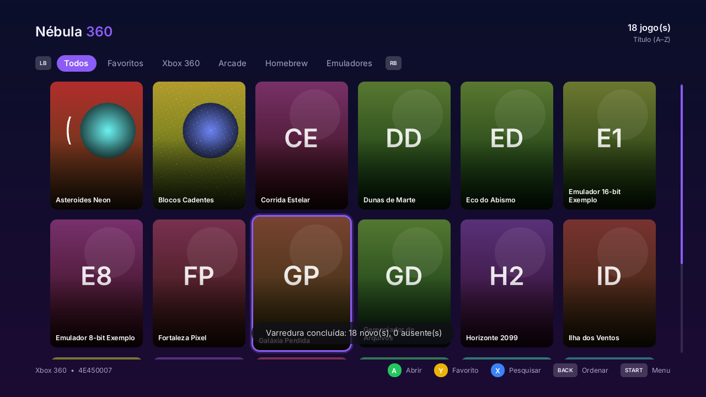

# Nébula 360

Central para Xbox 360 (RGH/JTAG) com biblioteca de jogos, loja de homebrews
gratuitos e autorizados, emuladores, multimídia e ferramentas do sistema.
Aplicativo próprio, escrito do zero; inspirado em ideias do Aurora e do
GodStix, **sem** reutilizar código ou recursos de nenhum dos dois.

## Estado atual: Fase 2 — biblioteca de jogos

- Interface 1280×720 navegável pelo controle (grade, abas, detalhes, teclado
  virtual, menus, temas).
- Detecção de jogos (pastas com `default.xex`/`default.xbe`, contêineres
  GOD/XBLA), biblioteca local, capas locais, filtros, pesquisa e favoritos.
- Arquitetura da loja (política de licenças, SHA-256, fila de downloads).
- Registro de módulos com manifesto, dependências, conflitos de porta,
  orçamento de memória e modo seguro após encerramentos inesperados.
- 75 testes automatizados, rodando também em PowerPC big-endian (qemu).
- **Ainda não há executável para o console**: exige um toolchain do Xbox 360
  (o XDK proprietário ou o xsdk aberto, este pendente de autorização). Detalhes
  em [docs/analise/DEPENDENCIAS_NEBULA360.md](docs/analise/DEPENDENCIAS_NEBULA360.md).



## Compilar e testar (PC)

Requisitos: CMake ≥ 3.16, GCC ou Clang, opcionalmente SDL2 (janela).

```bash
cmake -S . -B build -G Ninja && cmake --build build && ./build/nebula_tests
```

Rodar com uma biblioteca de demonstração fictícia:

```bash
python3 -I tools/demo/make_demo_data.py /tmp/demo && ./build/nebula360 --data /tmp/demo/dados
```

Testar a detecção sobre uma cópia do HD do console:

```bash
./build/nebula_scan --json /caminho/para/copia/do/hd
```

## Documentação

| Documento | Conteúdo |
|---|---|
| [docs/fases/FASE_2.md](docs/fases/FASE_2.md) | Fase 2: arquitetura, funcionalidades, testes, limitações e próximo passo |
| [src/platform/xbox360/README.md](src/platform/xbox360/README.md) | Como levar o código ao console (exige XDK) |
| [docs/formatos/library-export-v1.md](docs/formatos/library-export-v1.md) | Exportação aberta da biblioteca (integrações, ex.: Neutro X) |
| [docs/formatos/catalogo-loja-v1.md](docs/formatos/catalogo-loja-v1.md) | Catálogo da loja e política de licenças |
| [docs/analise/RESUMO_PLUGINS.md](docs/analise/RESUMO_PLUGINS.md) | Resumo de plugins e dependências (Aurora 0.7b.2, GodStix 0.9.2) |
| [docs/analise/DEPENDENCIAS_NEBULA360.md](docs/analise/DEPENDENCIAS_NEBULA360.md) | Matriz de módulos, DashLaunch, downloads, toolchain e licenças |
| [docs/arquitetura/SISTEMA_DE_PLUGINS.md](docs/arquitetura/SISTEMA_DE_PLUGINS.md) | Arquitetura de módulos e extensões |
| [docs/fases/PLANO_IMPLEMENTACAO_PLUGINS.md](docs/fases/PLANO_IMPLEMENTACAO_PLUGINS.md) | Ordem de implementação e matriz de testes |
| [docs/analise/](docs/analise/) | Análises: XEX (Fase 1), plugins do Aurora e do GodStix |
| [THIRD_PARTY_NOTICES.md](THIRD_PARTY_NOTICES.md) | Componentes de terceiros (stb, fonte Inter) |
| [references/xex/README.md](references/xex/README.md) | Procedência dos XEX de referência (não versionados) |

## Ferramentas

- `tools/xex/xex_info.py` — lê o cabeçalho em texto claro de um XEX2
  (somente leitura, sem descriptografar).
- `tools/demo/make_demo_data.py` — gera uma biblioteca fictícia para
  demonstração.
