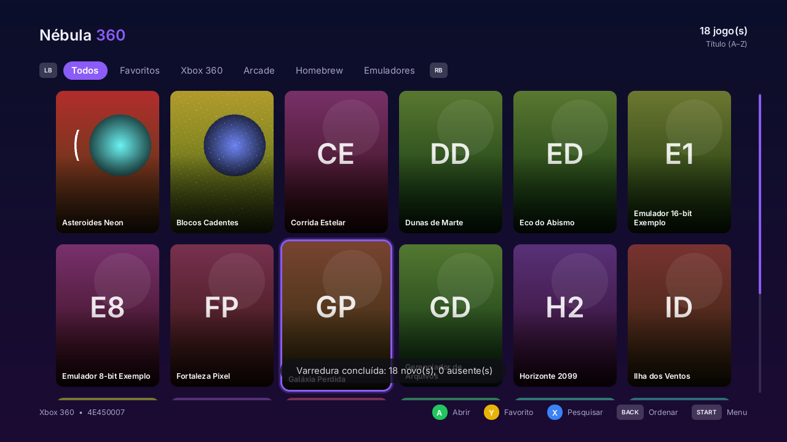
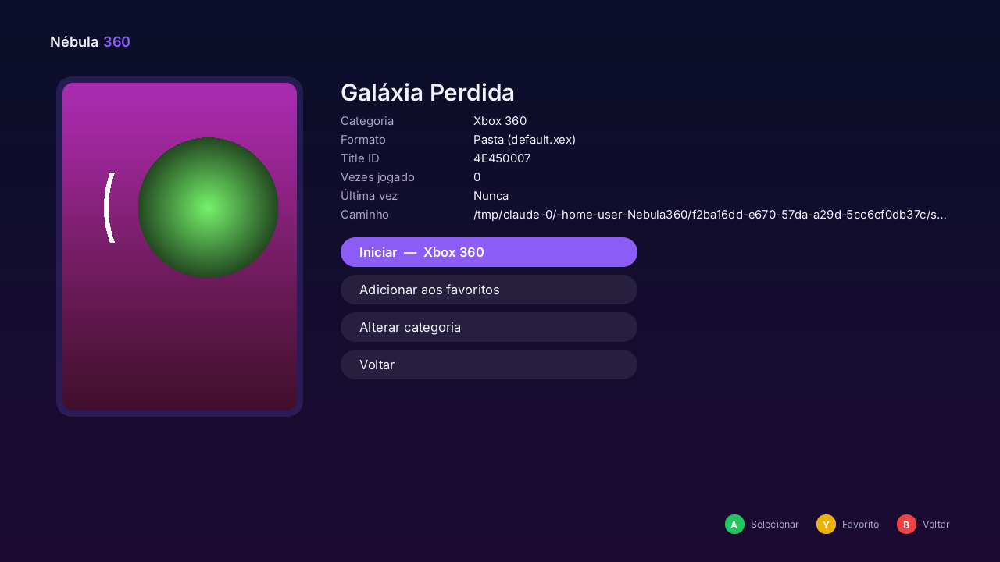
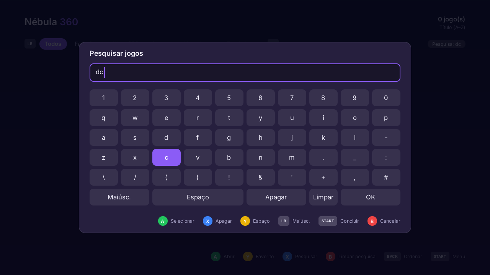
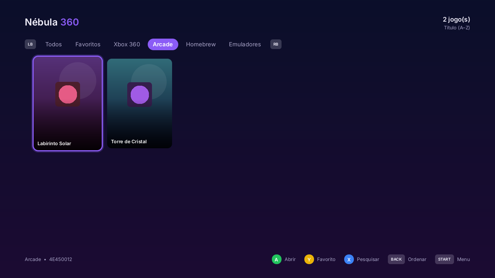
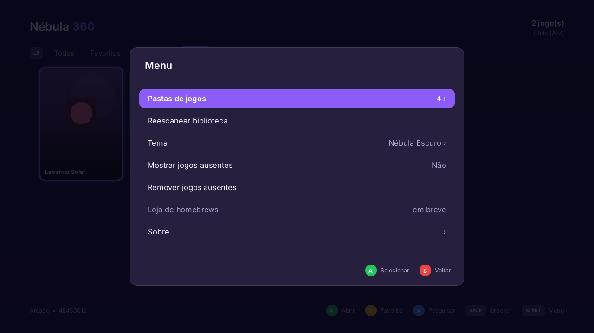
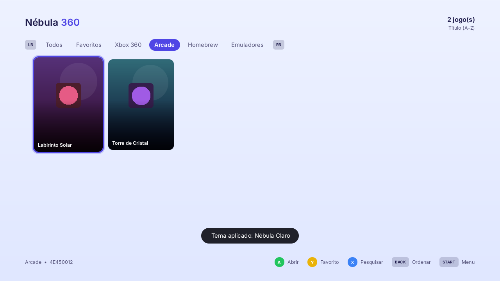

# Fase 2 — Desenvolvimento inicial (biblioteca de jogos)

> Data: 14/11/2026 · Branch: `claude/zen-meitner-rog40f` · Base: análise da Fase 1 (`docs/analise/`)

## 1. Resumo

| Item pedido | Situação |
|---|---|
| 1. Estrutura modular | Feito: `core`, `platform`, `formats`, `library`, `theme`, `store`, `integrations`, `ui`, `app` |
| 2. Interface 1280×720 navegável pelo controle | Feito e testado **no PC** (renderizador por software, entrada simulada e janela SDL2). **Não** testado em console. |
| 3. Detecção de jogos nas pastas do usuário | Feito: pastas com `default.xex`, `default.xbe`, contêineres GOD/XBLA/demo; varredura incremental |
| 4. Biblioteca local com título, caminho, capa e categoria | Feito: `library.json`, capas locais, miniatura extraída de GOD/XBLA |
| 5. Filtros, pesquisa e favoritos | Feito: abas por categoria, favoritos, pesquisa sem acento por título/Title ID, 4 ordenações |
| 6. Sistema de temas | Feito: 3 temas em JSON, troca em tempo real, temas do usuário em `<dados>/themes` |
| 7. Arquitetura da loja de homebrews autorizados | Feito: catálogo com política de licença, SHA-256, FATX, fila de downloads (sem rede ainda) |
| 8. Erros, logs e testes automatizados | Feito: `Status`/`Result` sem exceções, logs em arquivo com rotação, **56 testes** |
| 9. Compatibilidade futura com o Neutro X | Preparada por contrato aberto (exportação JSON + `IIntegration`); nada do Neutro X incorporado |
| 10. Documentação | Este arquivo, `docs/formatos/` e `src/platform/xbox360/README.md` |
| Gerar o executável do Xbox 360 (`.xex`) | **Não feito**: falta o XDK (seção 3) |

Todo o código é próprio. Nada do Aurora ou do GodStix foi incorporado (código,
imagens, textos, servidores ou catálogos). Terceiros: só stb (MIT/domínio
público) e a fonte Inter (OFL-1.1); ver `THIRD_PARTY_NOTICES.md`.

## 2. Arquitetura

```
apps/
  nebula_host/        frontend de PC: modo headless (roteiros/capturas) e janela SDL2
  nebula_scan/        CLI: roda o scanner sobre pastas do PC (ex.: cópia do HD do console)
src/
  core/               Status/Result, logs, UTF-8, JSON, SHA-256, caminhos, cores
  platform/           interfaces IFileSystem, IClock, ILauncher + FS em memória
    host/             POSIX (PC)
    win32/            Win32FileSystem + XInput (API comum ao Windows e ao XDK)
    xbox360/          RASCUNHO não compilado: montagem de dispositivos, D3D, laço principal
  formats/            leitura de cabeçalhos XEX2 e STFS (só campos em texto claro)
  library/            categorias, jogo, scanner incremental, biblioteca, consultas, capas
  theme/              temas (cores e medidas) em JSON
  store/              catálogo, política de licenças, regras FATX, fila de downloads
  integrations/       exportação aberta da biblioteca + registro de adaptadores
  ui/                 renderizador, fontes, imagens, entrada, telas e componentes
  app/                configuração e raiz de composição (App)
assets/               fontes, temas, textos pt-BR
tests/                56 testes (framework próprio, C++03)
tools/demo/           gera biblioteca fictícia para demonstração/capturas
```

### Decisões técnicas

- **C++03 estrito** (`-std=c++98 -pedantic-errors -Werror`) em todo `src/`:
  o compilador do XDK é o do Visual Studio 2010. Nada de `auto`, lambdas,
  `nullptr`, range-for ou bibliotecas C++11. Sem exceções e sem RTTI.
- **Sem threads**: scanner e downloads avançam um pouco por quadro
  (`step()`), então a interface nunca trava e o código não depende de
  primitivas de thread do XDK.
- **Portabilidade de ordem de bytes**: toda leitura binária é feita byte a
  byte em big-endian (`ByteReader`). Verificado rodando os testes em PowerPC
  big-endian (seção 5).
- **Offsets de 32 bits**: no Xbox 360 `size_t` tem 32 bits; o leitor de XEX
  descarta deslocamentos fora do buffer **antes** de somar, para não haver
  estouro (há um teste específico).
- **Renderização em camadas**: as telas desenham via `IRenderer`. A primeira
  implementação é por software (testável pixel a pixel); no console o
  framebuffer é enviado à GPU. Um renderizador Direct3D pode substituí-la
  sem mudar as telas.
- **Gravação segura**: biblioteca e configuração são gravadas em arquivo
  temporário e depois substituem o original. Arquivos corrompidos viram
  `*.corrompido` e o aplicativo continua com padrões, avisando na tela.

## 3. Ambiente de compilação do Xbox 360 — verificação

| Requisito | Situação neste ambiente |
|---|---|
| **Xbox 360 XDK** (Microsoft; compilador, `xtl.h`, D3D9 Xenon, `xapilib`, `xboxkrnl.lib`, `imagexex`) | **Indisponível.** É software proprietário, distribuído só a desenvolvedores licenciados pela Microsoft. O programa de desenvolvimento do Xbox 360 foi encerrado; cópias que circulam pela internet não têm licença de uso para terceiros. **Não foi baixado nem usado.** |
| Visual Studio 2010 + Windows | Indisponível (o ambiente é Linux em nuvem). |
| Console Xbox 360 RGH/JTAG para testes | Indisponível. |
| Alternativa livre: libxenon/Free60 (GPL-2.0) | Disponível em tese, mas roda *bare-metal* (via XeLL), **sem** o kernel e o XAM do sistema: sem perfis, sem lançamento de jogos, sem os serviços do dashboard. Não serve para uma central de jogos. |

**Consequência:** nenhum `.xex` foi gerado e **nenhum teste foi feito em
console**. Para gerar o executável é preciso:

1. uma cópia do XDK obtida **com licença** (decisão e responsabilidade do
   projeto);
2. um PC Windows com Visual Studio 2010;
3. um console RGH/JTAG de testes;
4. seguir o roteiro de `src/platform/xbox360/README.md`.

O que **foi** possível verificar sem o XDK está na seção 5.

## 4. Funcionalidades

### 4.1 Interface (1280×720) e controles

Coordenadas lógicas fixas de 1280×720, com margens de área segura de TV
(64×36 px, configuráveis por tema).

| Tela | Controles |
|---|---|
| Biblioteca (grade) | Direcional/analógico: mover · **LB/RB**: categoria · **LT/RT**: página · **A**: detalhes · **Y**: favorito · **X**: pesquisar · **B**: limpar pesquisa · **Back**: ordenação · **Start**: menu |
| Detalhes do jogo | ↑/↓ escolher ação · **A**: Iniciar / Favoritar / Alterar categoria / Voltar · **Y**: favorito · **B**: voltar |
| Teclado virtual | Direcional: tecla · **A**: digitar · **X**: apagar · **Y**: espaço · **LB**: maiúsculas · **Start**: concluir · **B**: cancelar (restaura o texto) |
| Menu e listas | ↑/↓ · **A**: selecionar · **X**: ação extra (ex.: adicionar pasta) · **B**: voltar |
| Varredura | **B**: cancelar |

Direcionais e gatilhos repetem quando mantidos (380 ms de atraso, 90 ms de
intervalo, 45 ms após 1,5 s). Analógico com zona morta de 0,55.

No PC (janela SDL2): setas, Enter (A), Esc (B), X, Y, Q/E (LB/RB),
PageUp/PageDown (LT/RT), Tab (Back), M (Start), F12 (captura), F10 (sair).
Um controle de Xbox 360 ligado ao PC também funciona (SDL GameController).

Capturas reais da interface (biblioteca **fictícia** gerada por
`tools/demo/make_demo_data.py`; capas são arte procedural do próprio
projeto):

| | |
|---|---|
|  |  |
|  |  |
|  |  |

### 4.2 Detecção de jogos

Pastas configuradas em **Menu › Pastas de jogos** (ou em `nebula.json`),
cada uma com categoria padrão (`auto` ou fixa), profundidade máxima e
ativação.

| Encontrado | Formato | Categoria automática |
|---|---|---|
| Pasta com `default.xex` | `xex` | `xbox360` se o XEX tiver `EXECUTION_INFO` com Title ID válido; senão `homebrew` |
| Pasta com `default.xbe` | `xbe` | `xbox_classic` |
| Arquivo sem extensão em pasta de 8 dígitos hex, assinatura `CON `/`LIVE`/`PIRS` | `god` / `xbla` | pelo tipo de conteúdo: `0x7000` GOD → `xbox360`, `0xD0000` → `arcade`, `0x80000` → `demo`, `0x5000` → `xbox_classic` |

Outros detalhes:

- Pastas `*.data`, `$SystemUpdate`, `Cache` e ocultas são ignoradas.
- Não desce dentro de uma pasta de jogo.
- O nome vem do cabeçalho STFS (UTF-16) ou do nome da pasta.
- A categoria da pasta de varredura vence a automática, e a escolha manual
  do usuário (em Detalhes) vence ambas.
- **Pendrive desconectado não apaga nada**: jogos só são marcados como
  ausentes se a pasta raiz deles foi lida com sucesso. Ausentes mantêm
  favoritos e histórico, ficam ocultos por padrão e podem ser removidos no
  menu.
- Limitação conhecida: o XEX não guarda o nome do jogo em texto claro (o
  nome fica no recurso SPA, dentro da imagem criptografada). Por isso jogos
  extraídos usam o nome da pasta.

### 4.3 Biblioteca e capas

`<dados>/library.json` (esquema 1) guarda, por jogo: id estável, título,
caminho, pasta, formato, categoria detectada e escolhida, capa, Title ID,
Media ID, favorito, ausente, data de inclusão, última vez jogado e número de
vezes.

Ordem de busca da capa (só arquivos locais do usuário):

1. `<dados>/covers/<TitleID>.png|jpg`
2. `<dados>/covers/<id>.png|jpg`
3. `cover.*`, `boxart.*` ou `folder.*` na pasta do jogo (só XEX/XBE)
4. miniatura PNG extraída do contêiner GOD/XBLA para `<dados>/cache/icons/`
5. sem imagem: arte de marcador gerada (gradiente e iniciais)

O Nébula **não inclui capas** no pacote: a arte pertence às editoras. A
interface `ICoverProvider` está pronta para uma fonte online que o próprio
usuário configure (não implementada nesta fase). As capas são decodificadas
no máximo 2 por quadro e mantidas num cache LRU de 96 imagens.

### 4.4 Filtros, pesquisa e favoritos

- **Abas**: Todos, Favoritos e uma aba para cada categoria presente.
- **Pesquisa**: todos os termos precisam casar (E lógico), sem acento e sem
  diferenciar maiúsculas ("orion" encontra "Órion"). Também aceita prefixo
  do Title ID com 4 ou mais dígitos hex. A lista filtra ao vivo enquanto se
  digita.
- **Ordenação** (botão Back): título A–Z, adicionados recentemente, jogados
  recentemente, mais jogados. Fica salva na configuração.
- **Favoritos**: Y na grade ou nos detalhes. Salvamento automático 1 s após
  a última mudança.

### 4.5 Temas

Cada tema fica em `assets/themes/<id>/theme.json`; temas do usuário podem ir
para `<dados>/themes/<id>/theme.json`. Formato (esquema 1):

```json
{
  "schema": 1, "id": "meu-tema", "name": "Meu Tema", "author": "Eu", "version": "1.0",
  "colors": { "backgroundTop": "#0B0F2A", "backgroundBottom": "#1C0B33",
              "surface": "#FFFFFF14", "surfaceFocused": "#FFFFFF2E", "accent": "#8B5CF6",
              "accentText": "#FFFFFF", "text": "#F4F2FF", "textMuted": "#A8A3C7",
              "favorite": "#FACC15", "danger": "#F87171", "overlay": "#050614D0" },
  "metrics": { "safeMarginX": 64, "safeMarginY": 36, "headerHeight": 64, "tileWidth": 168,
               "tileHeight": 232, "tileSpacing": 18, "columns": 6, "cornerRadius": 12,
               "fontTitle": 30, "fontBody": 20, "fontSmall": 15 }
}
```

Cores aceitam `#RRGGBB` ou `#RRGGBBAA`. Campos ausentes herdam do tema
padrão. Valores inválidos são ignorados com aviso no log, e medidas fora do
intervalo são ajustadas, então um tema mal escrito nunca deixa a tela
ilegível. Temas incluídos: **Nébula Escuro** (padrão), **Nébula Claro** e
**Alto Contraste** (blocos e fontes maiores). `backgroundImage` está
reservado para uma fase futura.

### 4.6 Loja de homebrews (só arquitetura)

Ver `docs/formatos/catalogo-loja-v1.md`. A política está no código: só
licenças livres reconhecidas ou autorização escrita registrada; copyleft
exige link do código-fonte; não existe categoria para jogos comerciais; todo
arquivo exige SHA-256; caminhos validados contra as regras do FATX. A fila de
downloads grava em `.part`, confere tamanho e hash, tenta até 3 vezes e
nunca aceita mais bytes que o esperado. No menu, a loja aparece como
"em breve".

### 4.7 Erros e logs

- Erros como valores (`Status`, `Result<T>`); nenhuma exceção.
- Logs em `<dados>/logs/nebula.log` (rotação para `.1` acima de 512 KB;
  avisos e erros gravados na hora; nível configurável em `logLevel`).
- Falhas que o usuário precisa saber viram **aviso na tela**: configuração
  ou biblioteca corrompida, falha ao salvar (com nova tentativa a cada 5 s),
  pastas ilegíveis na varredura, tema inexistente, lançamento indisponível.
- Limites contra arquivos malformados: cabeçalho XEX até 1 MiB e no máximo
  256 cabeçalhos opcionais; JSON com profundidade máxima de 64; imagens até
  4096×4096 e 8 MiB; até 20.000 entradas por pasta.

### 4.8 Compatibilidade futura com o Neutro X

Não há informação pública sobre o Neutro X (busca feita em 14/11/2026, sem
resultados), então **nada foi presumido nem incorporado**. A compatibilidade
foi preparada por contratos abertos:

1. **Exportação da biblioteca** em `<dados>/export/library.v1.json`, num
   formato estável e documentado (`docs/formatos/library-export-v1.md`),
   regravada a cada salvamento.
2. **`IIntegration`** (`src/integrations/Integration.h`): adaptadores
   notificados a cada salvamento da biblioteca; falhas de um adaptador não
   afetam o resto.

Quando a especificação do Neutro X estiver disponível, um adaptador próprio
pode ser escrito sobre esses contratos.

## 5. Testes realizados (resultados reais)

Todos executados neste ambiente (Linux x86-64, GCC 13.3, CMake 3.28) em
14/11/2026:

| Verificação | Comando | Resultado |
|---|---|---|
| Compilação C++03 estrita (`-pedantic-errors -Werror`) | `cmake --build build` | **0 avisos, 0 erros** |
| Suíte de testes (x86-64) | `./build/nebula_tests` | **56/56 passaram** |
| Suíte com AddressSanitizer + UBSan + detecção de vazamento | build `build-asan` | **56/56, nenhum erro de memória, comportamento indefinido ou vazamento** |
| Compilação cruzada **PowerPC 32-bit big-endian** (mesma ordem de bytes e tamanho de ponteiro do Xbox 360) | toolchain `cmake/toolchains/powerpc-linux-gnu.cmake` | **0 avisos** |
| Suíte rodando em PowerPC big-endian (`qemu-ppc`) | `ctest --test-dir build-ppc` | **56/56 passaram** |
| Camada Win32/XInput compilada contra cabeçalhos do Windows | `i686-w64-mingw32-g++ -std=c++98 -pedantic-errors -Werror` | **compila sem avisos** (não executada) |
| Frontend SDL2 | `SDL_VIDEODRIVER=dummy NEBULA_MAX_FRAMES=30 ./build/nebula360` | abriu, rodou 30 quadros e saiu com código 0 |
| Scanner sobre biblioteca fictícia em disco | `./build/nebula_scan <demo>/jogos` | 18 itens, 0 erros |
| Capturas da interface | `./build/nebula360 --headless --script ...` | 6 capturas, conferidas visualmente (seção 4.1) |
| Custo de quadro do renderizador por software | benchmark ad-hoc | ~1 ms/quadro num Xeon 2,1 GHz. **Não** indica o desempenho no Xenon. |

Os 56 testes cobrem:

- **Núcleo**: UTF-8/UTF-16, normalização de busca, JSON (inclusive erros
  com linha/coluna e limite de profundidade), SHA-256 com os vetores do NIST
  (inclusive 1.000.000 × "a"), caminhos `Hdd1:\`, cores, datas, logs com
  rotação, sistema de arquivos insensível a maiúsculas como o FATX.
- **Formatos**: XEX2 e STFS sintéticos, entradas truncadas ou maliciosas
  (offsets perto de `0xFFFFFFFF`), miniatura inválida. Também lê os
  cabeçalhos dos `Aurora.xex`/`GodStix.xex` de referência quando presentes
  (pulado se ausentes).
- **Biblioteca**: varredura de uma árvore no estilo do HD do console (todos
  os formatos, profundidade, pastas ignoradas, categoria por pasta, pendrive
  ausente, arquivo ilegível, cancelamento), mesclagem, ausentes e
  restauração, persistência e corrupção, consultas, capas, configuração.
- **Loja**: política de licenças, rejeições com motivo, FATX, download com
  verificação, adulteração, falha de rede com novas tentativas, excesso de
  dados, cancelamento.
- **Temas**: herança parcial, validação, limites, tema quebrado, temas
  incluídos.
- **Interface**: borda e repetição de botões, analógico, primitivas de
  desenho e recorte, PNG, fonte Inter, quebra e reticências, textos pt-BR,
  cache de capas.
- **Aplicativo completo**: primeira execução, varredura inicial, navegação
  pelo controle, detalhes e favoritos com salvamento automático, abas,
  ordenação, pesquisa pelo teclado virtual (inclusive cancelar), troca de
  tema com verificação de pixels, lançamento, gerenciamento de pastas pelos
  menus, recuperação de arquivos corrompidos e de falhas de gravação, falta
  de fontes.

**Não testado:** nada foi executado em Xbox 360 real ou emulador de Xbox
360. Não houve teste com jogos, contêineres GOD/XBLA ou capas reais (só
dados sintéticos e fictícios).

### Como reproduzir

```bash
cmake -S . -B build -G Ninja && cmake --build build && ./build/nebula_tests
```

```bash
cmake -S . -B build-ppc -G Ninja -DNEBULA_WITH_SDL2=OFF -DCMAKE_TOOLCHAIN_FILE=cmake/toolchains/powerpc-linux-gnu.cmake && cmake --build build-ppc && ctest --test-dir build-ppc
```

```bash
python3 -I tools/demo/make_demo_data.py /tmp/demo && ./build/nebula360 --data /tmp/demo/dados
```

## 6. Limitações

1. **Sem executável de Xbox 360** e sem nenhum teste em console (falta o
   XDK, seção 3). A camada `src/platform/xbox360/` é um rascunho nunca
   compilado.
2. **Lançamento**: no console só está previsto para XEX (`XLaunchNewImage`).
   GOD, XBLA e XBE ainda não; no PC lançar é simulado (aviso na tela).
3. **Cabeçalho STFS** validado só com dados sintéticos montados a partir da
   documentação pública. Precisa ser confirmado com pacotes reais do usuário
   (a CLI `nebula_scan` serve para isso no PC).
4. **Nome de jogos extraídos** vem da pasta (o nome real está dentro da
   imagem criptografada do XEX, que o projeto não descriptografa).
5. **Desempenho no Xenon desconhecido**: o renderizador por software custa
   cerca de 1 ms no PC, mas a CPU do console é bem mais lenta por núcleo.
   Se não atingir 60 quadros/s, o próximo passo é um `IRenderer` em Direct3D.
6. **Loja**: só arquitetura; sem cliente HTTP, servidor, assinatura de
   catálogo nem tela.
7. **Capas online**: só a interface (`ICoverProvider`); nenhuma fonte
   implementada.
8. **Idiomas**: só pt-BR (a estrutura aceita outros arquivos em
   `assets/lang/`).
9. **Licença do Nébula ainda não definida**: sem um arquivo `LICENSE`, o
   código fica com todos os direitos reservados por padrão. A escolha (ex.:
   MIT ou GPL) é do responsável pelo projeto.

## 7. Próximo passo recomendado

1. **Decidir como obter o ambiente de compilação do console legalmente**
   (XDK licenciado) e quem terá um console RGH/JTAG de testes.
2. Com o XDK: compilar `src/` + `platform/win32` + `platform/xbox360` e
   validar no console, nesta ordem: tela, controle, leitura de `Hdd1:`,
   varredura, gravação, lançamento de um homebrew XEX. Medir quadros/s.
3. Enquanto isso, sem o XDK: rodar `nebula_scan` sobre uma cópia real do HD
   do console, para validar a detecção de GOD/XBLA.
4. Escolher a licença do projeto.
5. Fase 3 sugerida: lançamento de GOD/XBLA, `IRenderer` em Direct3D (se
   necessário) e cliente HTTP + assinatura de catálogo para a loja.
